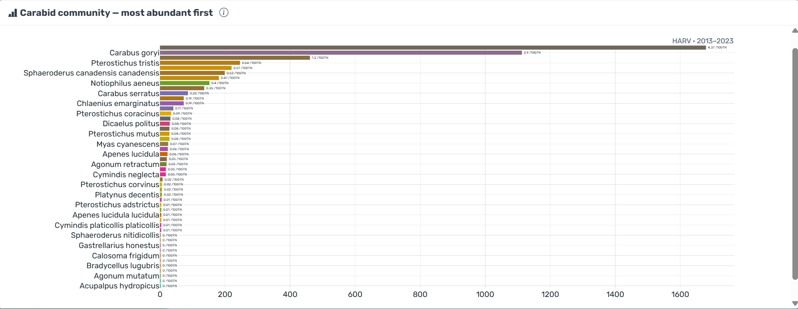
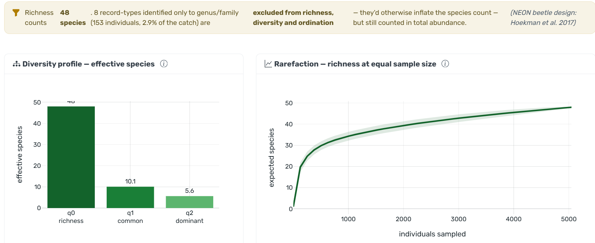
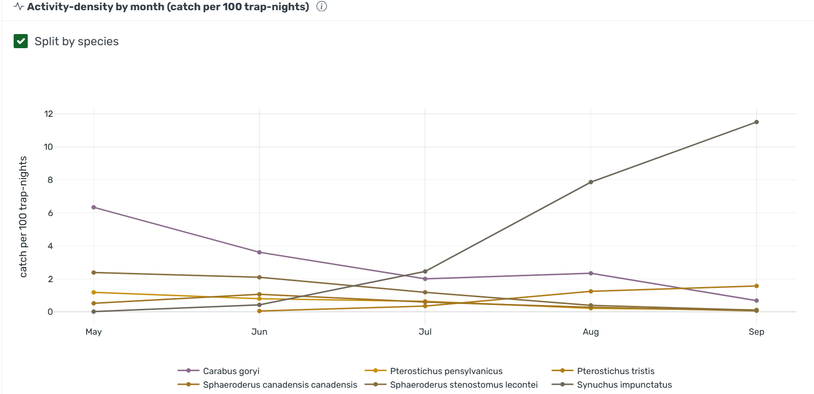
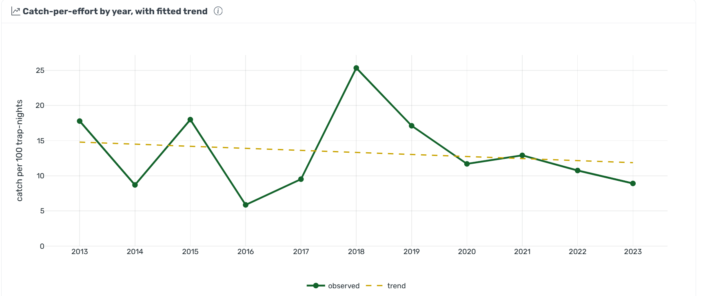
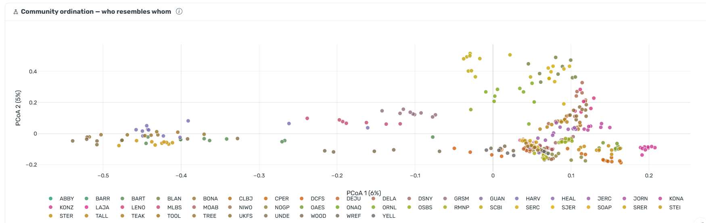
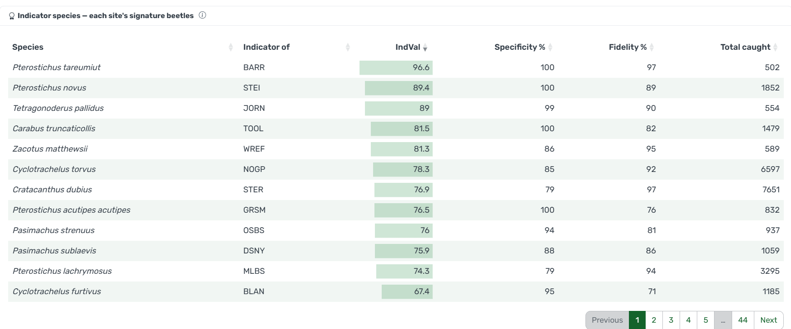

# 🪲 NEON Ground Beetle Tracker

An interactive R/Shiny app for exploring **ground beetle (Carabidae) biodiversity**
across the National Ecological Observatory Network, from NEON data product
[**DP1.10022.001, Ground beetles sampled from pitfall traps**](https://data.neonscience.org/data-products/DP1.10022.001).

Ground beetles provide useful community and disturbance context, but pitfall catch
is an activity-density index rather than population density or a site-health score.
The app explores observed richness, composition, seasonality, and change while
keeping those limits visible. It is one of ten NEON explorers from Desert Data Labs;
the suite hub is the
[NEON Cross-Product Response Atlas](https://tgilbert14.github.io/NEON-Driver-Cascade/),
and the closest sibling is the
[NEON Small Mammal Tracker](https://github.com/tgilbert14/NEON-Small-Mammal-Tracker-App),
which shares the house style and the bundle-first data pattern.

> **Live app:** <https://tgilbert14.github.io/NEON-Ground-Beetle-Tracker/>
> (a landing page that opens the dashboard hosted on Posit Connect Cloud).
>
> The bundle covers every NEON terrestrial site with released ground-beetle data,
> built from real DP1.10022.001 records (`data/sites/*.rds`), with the cross-site
> index, ordination and indicators precomputed to `data/precomputed.rds` so the app
> boots without a network call. The small `data-sample/beetle_demo.csv` is only an
> offline fallback. Re-pull the bundle with `scripts/refresh_data.R`.

## Data release and provenance

- The bundle holds **released data only**, pinned to one NEON release:
  **RELEASE-2026**, DOI <https://doi.org/10.48443/q9ne-6b77>, pulled with
  `include.provisional = FALSE`. That release runs through the 2023 trapping season.
- NEON also posts newer provisional records, but their expert IDs can still change,
  so they stay out until a release includes them. Moving to a newer release is a
  reviewed change to `GBT_RELEASE`.
- `data/release.rds` (written by `scripts/record_release.R`) records the release
  tag, DOI, citation and data-through date. The app shows them in the About tab,
  the methods dialog, the landing site count, the export README and the PDF report.
- Citation: NEON (National Ecological Observatory Network). Ground beetles sampled
  from pitfall traps (DP1.10022.001), RELEASE-2026.
  <https://doi.org/10.48443/q9ne-6b77>. NEON data are licensed CC BY 4.0.

## A look inside

<table>
  <tr>
    <td width="50%"><br><sub><b>Overview</b>: the top species ranked by abundance, labelled with catch per 100 trap-nights.</sub></td>
    <td width="50%"><br><sub><b>Diversity</b>: Hill numbers (q0/q1/q2) and rarefaction, with the species-vs-higher-taxa QA note.</sub></td>
  </tr>
  <tr>
    <td width="50%"><br><sub><b>Seasonality</b>: activity-density by month, split by species to show each one's peak.</sub></td>
    <td width="50%"><br><sub><b>Trends</b>: inter-annual catch-per-effort with a fitted trend.</sub></td>
  </tr>
  <tr>
    <td width="50%"><br><sub><b>Biogeography</b>: a Bray-Curtis PCoA placing every site x year community; sites cluster by biome.</sub></td>
    <td width="50%"><br><sub><b>Indicator species</b>: each site's signature beetles by Dufrêne-Legendre IndVal.</sub></td>
  </tr>
</table>

## What it does

| Tab | What you see |
| --- | --- |
| **Overview** | Carabid community composition (the top species by abundance and catch per 100 trap-nights), detection frequency, "meet the beetles" cards and a data-quality review. |
| **Diversity** | Hill numbers (q0/q1/q2 effective species), Hurlbert rarefaction (richness at equal sample size), species accumulation across bouts and rank-abundance. |
| **Seasonality** | Activity-density by month (catch per 100 trap-nights), overall or split by the top species, a phenology heatmap, and an exploratory seasonal-climate read. |
| **Trends** | Inter-annual catch-per-effort with a fitted OLS trend line and a plain-language verdict. A trend is called clear only if it also holds without the 2023 value and without partial-season years. |
| **Biogeography** | A national map of every site with the same dot size (or a chosen species' range, sized by local abundance); a PCoA community ordination (Bray-Curtis); an indicator-species table (Dufrêne-Legendre IndVal); and a site table that is not a ranking. |
| **Search** | Find one beetle across every bundled site, or filter the network by introduced species or an activity-density cutoff. |
| **About** | Data product, release, methods, and links to the other NEON explorers. |

Tap a site on the landing map, or pick one by name in the panel below the map, and
it loads automatically (the date window snaps to that site's coverage). **Surprise
me** opens a random site. Choose a **Compare with** site to overlay a second site on
the Diversity and Seasonality charts.

Cross-site rankings stay held: sites differ in habitat, years sampled and trapping
effort, so the map, the site table and the Biogeography banner never order sites by
richness.

## How the numbers work

- **Effort-normalised abundance.** Counts are expressed as **catch per 100 trap-nights**.
  Effort comes from every distinct collected trap record, including sampled plot x
  bouts with zero Carabidae, so the denominator never depends on positive catch.
  Per-trap-night effort absorbs the 2018 change from 4 to 3 traps per plot. In 2023
  NEON cut sampling from 10 plots to 6, and the plots it kept can catch more or fewer
  beetles than the old set, so the 2023 value is not directly comparable with
  earlier years.
- **Diversity.** Hill numbers (Hill 1973; Jost 2006); individual-based rarefaction
  with an approximate SD band (Hurlbert 1971; Heck et al. 1975); sample-based
  species accumulation averaged over random bout orders (Gotelli & Colwell 2001).
- **Taxonomy.** The bundle reconciles parataxonomist IDs with the authoritative
  **expert taxonomist** IDs (`assemble_beetles()` in `R/helpers.R`). The species key
  is the binomial, so one species never counts twice under two names.
- **Species vs. higher taxa (QA/QC).** NEON records are not all named to species;
  some stop at genus (`Bembidion sp.`) or family (`Carabidae`). Counting those as
  distinct species inflates richness and diversity, so every richness-type metric
  (richness, Hill numbers, rarefaction, accumulation, ordination, indicator species)
  uses **species-level records only**, keyed on NEON's expert `taxonRank` with a
  scientific-name test (`is_species_level()`) as backstop. Total **abundance** still
  counts every beetle trapped. The Diversity tab reports how many records are
  excluded. Design ref: Hoekman et al. 2017, *Ecosphere* 8(4):e01744; indicator
  value: Dufrêne & Legendre 1997.

## Run it locally

```r
install.packages(c(
  "shiny", "bslib", "bsicons", "shinyjs", "shinycssloaders",
  "plotly", "dplyr", "tidyr", "RColorBrewer", "leaflet", "DT", "htmltools"
))
# neonUtilities is optional, only for the live-fetch path and the refresh script:
# install.packages("neonUtilities")

shiny::runApp()
```

The app opens on the landing map. Tap a site and choose **Explore this site**, or
pick a state and site in the panel below the map. Bundled sites load from disk.

## Build the real data bundle

```r
Rscript scripts/refresh_data.R
```

This downloads the pinned DP1.10022.001 release per site, assembles the carabid long
table (expert-ID reconciliation and per-trap-night effort), and writes
`data/sites/<SITE>.rds`. The app prefers a real bundle over the demo automatically.

## Project layout

```
global.R                  libraries, theme, data loaders, national site index, release identity, lazy NEON fetch
ui.R                      bslib dashboard (top bar, landing poster and picker, tabs)
server.R                  data flow and all outputs
R/helpers.R               analytical engine (Hill numbers, rarefaction, accumulation, assemble_beetles)
R/site_metadata.R         site code -> name / state / domain / coords / bio
scripts/refresh_data.R    build the per-site beetle bundle from NEON
data/sites/<SITE>.rds     bundled per-site carabid data (released NEON records)
data/release.rds          the NEON release the bundle is pinned to
data/precomputed.rds      cached cross-site index + ordination + indicators (fast boot)
data-sample/beetle_demo.csv  offline demo fallback (NOT real NEON data)
www/styles.css            theme CSS
manifest.json             Posit Connect Cloud deploy manifest (bundle-only)
```

## Built by Desert Data Labs

Tucson, AZ · custom data apps & analytics: **desertdatalabs@gmail.com**
Data: NEON DP1.10022.001, RELEASE-2026. Not affiliated with NEON, Battelle, or the
NSF. An educational data-exploration tool.
